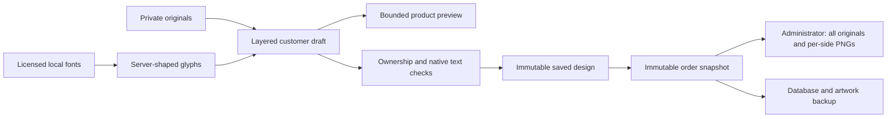

# Product design studio

Artists upload an original, preview it on seven generic products, adjust each placement, and save a private draft or submit for administrator review. The English and Arabic studio share the same original, product ID and placement data. Artwork is never mirrored in RTL. Upload replacements are atomic: an invalid/failed replacement keeps the previous accepted original and saved placements. Actual upload progress is shown; accepted uploads still need production review.

## Visual previews and limitations

The seven product families are T-shirts, tote bags, mugs, notebooks, phone cases, art prints and stickers. Templates are **provisional**: no supplier templates have been supplied. The current white generic product bases are AI-generated photographic-style illustrations, with manually calibrated surface meshes for deterministic artwork placement. They are not photographs of a supplier's actual goods. The initial Blender-based prototype has been superseded. The interface and exported PNG label them as visual previews, not print files or physical samples.

Each product retains independent position, scale, rotation, repetition, print-area background and view. The artist listing editor retains one design/placement per product family. The customer creative workspace now supports independent layered front/back shirt designs; see the customer section below. Mugs use opposite views of the same continuous wrap. Phone camera cutouts are generic and are not device-specific fit guarantees. Stickers use a generic rounded-square surface, not an automatic die-cut contour. Material color is the generic template color; background controls affect the printable area only.

Drag on the product's printable surface to reposition; keyboard arrows adjust by 1% (Shift: 5%). Numeric controls allow exact logical placement. The dashed guides show the provisional printable boundary and a 5% inset. No supplier bleed, spot colors, color matching, CMYK conversion, device-specific manufacturing file, or production-ready PDF is generated. Original bytes remain unchanged.

DPI estimates use the **oriented original image pixel dimensions** divided by the placed physical size inferred from the provisional 300-DPI canvas. They do not trust embedded DPI metadata. Below 150 DPI is flagged low, 150–299 requires review, and 300+ indicates a good resolution estimate only. Cropping and excessive pattern density are flagged separately. Notebook/phone templates have no confirmed physical canvas and always require a supplier template, with no numeric DPI claim. Transparent margins in an original still count toward its dimensions; the artist and administrator must inspect usable artwork, not just this estimate.

Selecting a preview also selects the preferred listing category when the listing-mockup option is checked. Requested product checkboxes are review requests for this same design, not automatic creation of seven sellable SKUs. The administrator still controls category, price, stock, specifications and approval.

## Saved data and private files

`products.data.design_studio` contains version `1`, `template_version`, `artwork_id`, `active_product`, and per-product `placements`: normalized `x/y` (0–1), `scale` (0.1–2), `rotation` (−180–180), `repeat` boolean, `background` (`transparent` or 6-digit hex), and an allowed `view`. `listing_mockup` preserves the artist’s presentation-image preference. The server validates bounds and binds these settings to the exact original ID. No migration is required; these are additive JSON fields. Earlier listings without studio data remain editable.

On save, an authenticated artist/admin may request `POST design-mockup` with `{id?,upload_id,category,design_studio}` and CSRF. Source ownership or assignment is checked before reading the private file. The server independently renders a bounded 1000×1000 JPEG from the source's bounded lossless render preview and validated placements. It returns `{mockup_upload_id,source_upload_id}`. The derivative ID hashes the source, template version, category and placement, allowing safe reuse on repeated saves. Browser-generated preview bytes are never accepted as a trusted storefront mockup. Access is private until approval, following existing image authorization rules. An artist edit returns the listing to pending review.

`mockup_upload_id` is the storefront presentation image. `upload_id` remains the exact original for printing; order snapshots retain both IDs and the placement settings at purchase. These snapshots are visible only through the existing private order access rules. Product gallery photos remain separate. Unchecking the listing-mockup option clears the presentation derivative on save. Existing cached derivatives can remain in private storage and backups; do not delete upload records/files without checking current products, portfolios and historical orders.

Administrators open **Products → Design files** to download original(s) and **Download placement plan (.json)**. The plan includes source ID, original dimensions, requested product placements, quality estimates and explicit `supplier_confirmed:false`. It is a handoff aid, not a print-ready file. The original/ZIP download contains original attachments, not the generated mockup. Manage order also offers the placement plan captured at purchase (`admin-design-plan&id=PRODUCT_ID&order=ORDER_ID`); editing a listing later cannot change those order instructions. Orders placed before this feature have no placement snapshot. Private placement data is omitted from public bootstrap; administrator plan downloads are audited. Customers and artists cannot download the originals using the administrator endpoint.

## Supplier templates and assets

`public/assets/print-products.json` is the canonical provisional product configuration shared by client and server. Its preview aspect ratios correspond to the surface meshes in `public/assets/mockups/*.json`. Canvas pixels are provisional estimates; `null` explicitly means unknown physical dimensions. Before adding a real supplier, confirm printable dimensions, safe areas/bleed, device cutouts, product colors, print method, accepted source formats, ICC handling and a physical sample. Update geometry, projections and dimensions together, version the configuration, and adapt saved layouts explicitly; changing numbers alone does not create a matching supplier mockup.

The historical procedural prototype used this optional development tool (Blender 4.3; not a server dependency). This command does not reproduce the current photographic-style bases; use the photographic preparation command below:

```sh
VEELAD_RENDER_ENGINE=BLENDER_EEVEE_NEXT blender --background --threads 8 --python tools/render-mockups.py -- --output /tmp/veelad-mockups
```

Use Sharp to convert the PNGs to quality-90 WebP, and copy the paired projection JSON files into `public/assets/mockups/`. Review every view with asymmetric test artwork before publishing. Runtime rendering uses existing Sharp and browser Canvas. It does not generate images with an AI service, contact an external image provider, or require a new npm runtime dependency.

## Release and rollback

Run `npm run check`, `npm run build`, `npm test` and `npm run test:ui` with the documented local database. Browser tests cover both viewports, independent placements, language preservation, invalid replacements, preview export and reopening. Integration tests cover source/derivative ownership, private draft previews, publication, admin placement plans, caching and byte-exact original downloads.

Deploy development changes to staging. Production remains a separate deliberate release. Back up the database and private upload directory together before production. Reverting to the preceding private-artwork version preserves source files and additive JSON data, but its storefront will show the original preview rather than the new mockup. Never revert to a version that publicly serves full originals. Forward-fix mockup rendering failures; original printing files remain independent of disposable visual derivatives. Payment and email delivery settings are unchanged.

## Photographic presentation upgrade (2026-10-15)

The current base set is `render_version: veelad-photo-1`: AI-generated photographic-style blank products with cloth weave, stitching, folds, ceramic highlights, paper/case texture and lavender studio backgrounds. These are generic product illustrations, not photographs of verified stock or a selected supplier. Seller artwork is **never regenerated or sent to an image model**. The built-in image tool was used only to prepare blank bases during development; it is not called by the website and adds no runtime image-service dependency.

The browser and server now use the same bounded pixel surface projector with premultiplied-alpha bilinear sampling. Each pixel is sampled once, preserving translucent designs without overlapping triangle seams or darkened opacity. Cloth surface offsets derive from the photographed-style base luminance; mugs use a calibrated cylindrical wrap; phone camera openings and rounded sticker corners use explicit masks. Shadows/material detail come from compositing the unchanged artwork against the base. This improves appearance without certifying physical print accuracy. Server compositing uses an oriented, metadata-stripped, lossless PNG source capped at 1600 px, avoiding an additional lossy artwork encoding before rendering; web previews are WebP at quality 90, still bounded and separate from byte-exact originals.

Completed mockups use the full image area in storefront cards, galleries, thumbnails and order summaries. Raw artwork previews retain their separate inset treatment. `render_version` versions disposable visual derivatives independently of logical `template_version`, so existing placement coordinates and order snapshots remain valid. Authorized preview requests lazily build the upgraded derivative for old mockup IDs. The listing pointer, original, old derivative and saved order instructions are not rewritten. Unauthenticated requests cannot rebuild/view private drafts. Missing source/storage availability falls back to the existing preview where available; existing missing-file warnings still require restoration of the original.

Current preparation command:

```sh
node tools/prepare-photo-mockups.js /private/path/photo-sources.json
```

The source mapping is `{ "shirt": "/path/to/generated.png", ... }` for all nine view names. The original PNG masters are session artifacts; the committed WebP/projection pairs are the deployable source of truth. See `public/assets/mockups/README.md`. The Blender command above documents the historical prototype only, not the current photographic bases. No real payments or production branch changes are part of this staging update.

## Customer product galleries (2026-10-16)

Product galleries preserve the listing's main image and additional uploaded photographs. Listings with an original and a rendered mockup also offer a bounded original-artwork preview. Close-ups enlarge the same preview; they do not create additional printing detail. A compact horizontal thumbnail rail, labeled counter and keyboard/swipe navigation lead to a full-screen viewer with zoom, drag panning, reset and focus restoration. English and Arabic controls follow the page direction. Optional images arriving late preserve the selected image and viewer zoom; unavailable extras leave the original gallery usable.

`GET /api.php?route=product-gallery&id=PRODUCT_ID` describes supported additional views. Current provisional templates support another angle of the same mug wrap and an **unprinted** opposite side of a T-shirt. The mug keeps the saved artwork, placement and text; the opposite shirt view never invents printing on a second side. Other categories retain their normal images, artwork previews and close-ups until additional templates exist.

The metadata response provides a content signature and bounded preview URLs under `product-gallery-image`. Every metadata and image request checks current listing access; private listings require their assigned artist or an administrator, including cache hits. Stale signatures and unsupported views are rejected. Responses reveal no original file path or placement instructions and never provide print-original downloads. These remain in the existing authorized administrator/owner controls.

Additional images are 1000 px WebP derivatives held in a disposable process cache of at most 16 entries / 16 MiB. Two rendering slots, a bounded queue and a limit on new render work protect the runtime. No product, upload, order, account or mail record is changed to display these views. A restart discards the cache and authorized requests regenerate it. No new dependency, secret, database migration or image-service account is required. Reverting the gallery release preserves original files, existing mockups and order instructions.

## Customer creative workspace (2026-10-23)

The signed-in **Create your own** page has a flat, editable artboard and a separate product-preview mode. Customers can add multiple PNG/JPEG originals, mix text and images in any stacking order, drag, resize, rotate, change opacity, align to the centre, duplicate, hide, lock and reorder layers. Undo/redo retains complete scene snapshots; switching languages changes interface direction without mirroring artwork. T-shirts have independent **front** and **back** scenes. Copying between sides asks before replacing existing content. A mug has one **wrap** scene, shared by both preview camera angles. Other products currently have one front print surface.

The browser uses exact server-shaped text glyphs for the artboard and the same shared geometry as the print renderer. Selecting a font does not substitute browser fallback lettering in the production file. Image quality checks use native original dimensions, rather than the smaller browser image preview. Product previews remain illustrative and provisional. Saving a two-sided layout does not confirm a supplier's two-sided printing capability or a final surcharge.

Limits are explicit: 24 image/text layers per surface, 120 layers across all seven product layouts, 16 distinct originals per design, and 500 Unicode code points/12 lines per text layer. Each original remains limited to PNG/JPEG, 25 MiB and 60 megapixels. Large print exports and individual text rasters have bounded pixel budgets. Finalization checks text at the provisional native print size, so a layout that cannot be rendered is rejected before becoming an immutable ordered design. Drafts remain editable to correct such issues.

### Fonts

The local catalogue contains **152 font choices**, including **29 with Arabic coverage**, spanning **57 Unicode script codes**. This describes font coverage, not a promise that every language or every emoji is supported. Search by name, script and style; unsupported characters produce a helpful warning and server validation. Historical Manrope/DM Sans Arabic fallback is preserved when upgrading old layouts.

The font catalogue is requested only when the workspace needs it. Individual font files load on demand with at most four simultaneous browser downloads. CJK families are large and remain lazy. The website makes no runtime Google Fonts request. Browser sample fonts and server text rendering use the same pinned TTF files; licences, hashes, provenance and reproduction instructions are in [the font library README](../public/assets/fonts/library/README.md). `tools/prepare-design-fonts.py` reproduces the catalogue. Asset requests carry revision/hash versions to avoid stale Hostinger caches.

### Scene data and file safety

The version-1 studio envelope gains `scene_version: "veelad-scene-1"` and `scenes[productType][surface] = {background, layers}`. Image layers reference private `art-*` upload IDs and normalized width/height; text layers retain text, an allowlisted font, colour, normalized size, alignment and direction. Both share stable IDs, centre coordinates, rotation, opacity, visibility and locking. Array order defines stacking. `placements[type].view` selects a preview camera; it never overwrites the opposite print surface.



All image references, including hidden layers and other saved product layouts, are checked for ownership. Source lists are derived on the server. Missing secondary originals block finalization/checkout/production. Restoring or editing a draft never changes an earlier order. Existing single-image artist listings and historical version-1 orders keep their original rendering and hash behavior; upgrading is confined to the private customer editing workflow. No database migration is needed because existing JSON columns hold the additive scene data.

Administrators download **every unchanged original**, an order-specific ZIP, and separate **front/back/wrap composed PNGs** from the immutable order line. Native PNGs use full-resolution sources rather than browser thumbnails. The placement plan includes all surfaces, layers, source IDs and per-image DPI estimates. A composed PNG is still based on provisional dimensions; confirm supplier requirements before printing. The existing proof workflow records one latest proof per order line, so a multi-side proof must show both sides clearly in its image/caption.

### Relevant code

| Area | Files |
| --- | --- |
| Scene model and compatibility | `public/assets/customer-scenes.js`, `src/design-scenes.js`, `src/design-studio.js` |
| Responsive editing controls | `public/assets/customer-workspace.js`, `public/assets/customer-workspace.css` |
| Font registry and shaping | `src/font-library.js`, `src/text-layers.js`, `public/assets/design-fonts.js` |
| Print and preview compositing | `src/scene-renderer.js`, `src/mockup-renderer.js`, `public/assets/design-math.js` |
| Drafts, immutable designs and orders | `src/customer-drafts.js`, `src/app.js`, `public/assets/customer-library.js` |
| Administrator production handoff | `public/assets/production-files.js`, `production-workspace.js`, `print-job.js`, `src/production.js` |

Tests cover bounds, font licences/coverage, private ownership, missing secondary files, independent sides, stacking/opacity/clipping, native-source print detail, immutable snapshots, ZIP contents, client/server pixel parity, desktop/iPhone editing, autosave, language changes and existing artist workflows. Deployment remains staging-first. No production environment variables, production catalogue, supplier specifications or payment settings are changed by this editor upgrade.
