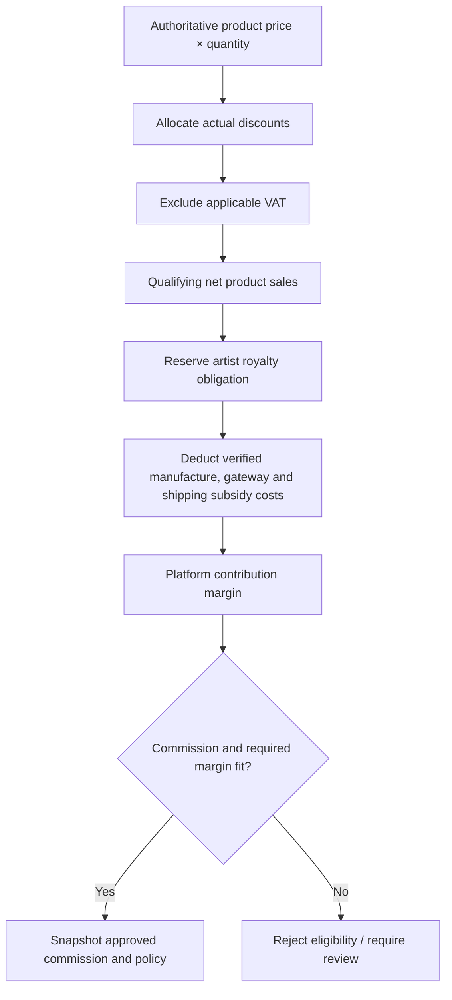
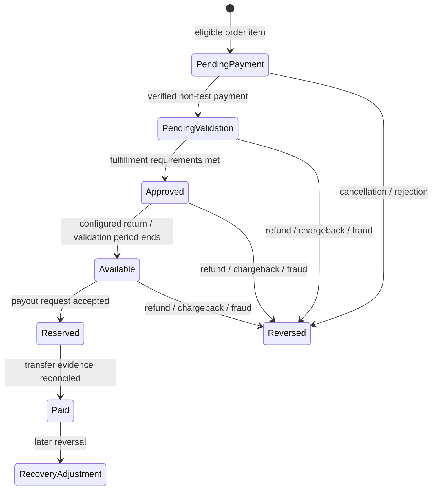

# Veelad Partners / شركاء فيلاد

This document describes the Partners module, its operational boundaries, and the decisions required before inviting real affiliates. It is a deployment and review guide, not legal advice or a statement of regulatory certification.

## Existing marketplace integration

Veelad uses Node.js 24, Express 5, MySQL/InnoDB, server-side sessions, and a plain JavaScript bilingual storefront. Partners is an additive module in that application. It does not replace authentication, checkout, production management, mail delivery, or the artist dashboard. Affiliate membership is separate from `users.role`: a buyer or artist can become a Partner without losing their existing account or artwork.

Before this module, artist order lines contained a `royalty_percent` snapshot and the artist workspace showed estimated earnings. There was **no settled artist royalty ledger or automated artist payout system**. The preserved 20% field is a compatibility placeholder, not evidence of an agreed artist contract. Product eligibility review must establish the real royalty obligation and costs before enabling commission-bearing promotion.

The existing Moyasar module only checks test credentials through a read-only provider request. It does not charge customers, verify live payment webhooks, or perform refunds. Existing manual payment recording is explicitly a nonproduction test operation. Partners must not convert those test orders into payable liabilities.

```mermaid
flowchart LR
    A[Existing verified account] --> B[Partner application]
    B --> C[Administrator review]
    C --> D[Approved partner]
    D --> E[Reviewed eligible products]
    E --> F[Product referral link]
    F --> G[Visitor consent]
    G --> H[Normal Veelad checkout]
    H --> I[Immutable per-item attribution and rate snapshot]
    I --> J[Verified payment and fulfillment checks]
    J --> K[Validation period]
    K --> L[Available commission]
    L --> M[Monthly payout review]
    M --> N[External bank transfer evidence]
    N --> O[Reconciled paid statement]
```



## Safe initial business settings

- The environment feature flag is off by default. Database program settings cannot override a disabled deployment flag.
- No commission percentage is presented as an agreed commercial rate. A zero default and product review prevent accidental earnings promises.
- A product requires reviewed, reliable cost information. Missing production costs, tax treatment, gateway costs, shipping subsidy, or contractual artist royalty information are review blockers, not values to be estimated as zero.
- Initial currency is SAR; money is stored in integer halalas and commission rates use basis points. 100 basis points equals 1%.
- Default tracking intent is the last eligible click for the promoted product within 30 days. It is not permission to track a visitor before consent.
- The validation delay, payout threshold, margin floor, eligible fulfillment milestone, promotion restrictions, and commercial rates require owner approval before launch.
- Payouts are a controlled manual reconciliation workflow. No API initiates a real bank transfer.

## Financial calculation and historical accuracy

The calculation distinguishes the customer-facing price from money available to Veelad. The reviewed product policy determines tax treatment and cost inputs. Discounts are allocated across order items deterministically in minor units; allocations must sum exactly to the order discount. Shipping charged to the customer and VAT are excluded from the qualifying product-sales base according to the approved policy.



An affiliate commission is funded by the platform's remaining margin. It must not reduce an artist's agreed share. Seller-funded campaigns are not implicitly authorized by becoming an artist or affiliate; they require a separate approved contractual opt-in before being supported commercially.

The order records authoritative product and selection snapshots. Partners records the applicable affiliate, link, campaign/coupon source, rate, eligible base, cost/margin assessment, and policy at the time of qualification. Later edits to product prices or commission rules do not silently rewrite historical earnings.

Commission state changes are financial events with ledger entries, not deletions. Repeated processing must be idempotent. A full cancellation, chargeback, fraud rejection, or full refund removes eligibility; a partial refund reduces commission proportionally using cumulative amounts so repeated delivery cannot reverse twice. A refund required by a cancelled order is not proof that the payment provider returned money.



Paid history remains visible after a reversal. Recovery is an explicit adjustment against future eligible earnings or a separately reviewed debt-recovery process. The application must never silently debit a bank account or erase a paid statement.

## Referral privacy and abuse controls

Referral destinations are constructed from approved internal product identifiers. Affiliates cannot supply arbitrary external redirect URLs. Product links retain stable product references rather than trusting the current title or slug.

Referral tracking requires an explicit visitor choice. A visitor can continue shopping after declining; declining does not authorize an analytics identifier, optional cookie, authenticated-account referral history, or a commission attributed through that declined click. Necessary account/session cookies remain governed by the existing store privacy information.

Authenticated account attribution only retains referrals when the visitor explicitly selects the additional account-memory option. It remains bounded by the attribution window and is not browser fingerprinting or automatic cross-device identity inference. The separate consented, HttpOnly referral cookie survives ordinary login and registration session rotation; its opaque value is hashed server-side and is not an affiliate ID supplied by the browser. Account-associated referrals remain scoped to the authenticated account. Signing out must not expose the previous customer's account referral state.

Product scope, current affiliate approval, expiry, campaign restrictions, customer identity, and coupon/link precedence are rechecked during checkout. Client-submitted affiliate IDs, commission rates, reported clicks, product prices, or payment-success claims are never financial authority. Shared household or IP information alone is not grounds to deny a legitimate commission; proportionate signals belong in the fraud review queue.

The implementation uses the existing session authentication, origin and CSRF checks, parameterized SQL, rate limiting, and private file controls. Every affiliate-owned query must be scoped by the authenticated account. Sensitive administrator actions require the relevant privilege and an audit event.

## Bank details and payout evidence

Initial payout details support Saudi IBAN validation, including checksum and country/length checks. Bank details are collected after application approval rather than during registration. Ordinary account and administration views receive masked values only.

Payout data is encrypted at rest with a dedicated deployment secret. Keep that key outside Git, logs, browser code, reports, and database exports. A database backup without the matching payout encryption key cannot recover encrypted bank details. Retain the key in a separately controlled recovery store and test recovery using disposable test data.

Updating payout details requires recent identity confirmation and a security hold. It must notify the account owner and be audit-logged without recording full bank details. Restrict full controlled bank export and reconciliation to explicitly authorized finance administrators.

The monthly workflow separates a partner's request, reserved available balance, administrative approval, an externally executed transfer, evidence submission, and reconciliation. A request or approval does not mean money was sent. A transfer reference and financial evidence are operator assertions that require comparison with actual bank records; the website cannot independently verify a bank transfer until a provider or statement reconciliation integration is implemented.

## Intellectual property and marketing materials

Only administrator-approved promotional assets with an appropriate rights basis are offered for download. Partner access does not grant access to private artist print originals, customer designs, restricted artwork, or production ZIP archives. The marketing toolkit should identify permitted use and include an editable affiliate disclosure in both languages.

Suggested disclosure language, subject to legal review:

> English: This is an affiliate link. I may earn a commission if you make a qualifying purchase through it.
>
> العربية: هذا رابط تسويقي بالعمولة. قد أحصل على عمولة إذا اشتريت منتجًا مؤهلًا من خلاله.

No caption should promise guaranteed income, imply an artist endorsed an affiliate without permission, invent a discount, or describe a draft price as a final commercial offer.

## Saudi legal, accounting and operational review

Before opening the program, obtain professional review of:

| Area | Required decision or review |
| --- | --- |
| PDPL and privacy | Controller/contact details, purposes and lawful bases, consent wording, processors, cross-border transfers, access/deletion process, retention schedule, breach response, and security controls. |
| Advertising | Affiliate relationship disclosures, prohibited tactics, influencer licensing or other applicable advertising requirements, truthful claims and sponsored content rules. |
| E-commerce terms | Contracting entity, eligibility, suspension/appeal procedure, complaint contact, commission conditions, payout timelines, termination and settlement. |
| VAT and ZATCA | Product price tax treatment, royalty and affiliate service tax treatment, VAT registration/document collection where needed, invoicing and e-invoicing obligations, record retention. |
| Artist agreements | Agreed royalty basis and rate, manufacturing/marketing licenses, promotional image permission, refund allocations, seller-funded campaign approval if introduced. |
| Payouts | Beneficiary eligibility, bank verification, monthly cut-off, minimum threshold, failed transfer handling, statement/evidence requirements, negative-balance recovery and international expansion. |
| Consumer operations | Confirmed delivery countries, supplier specifications, return/refund windows, actual costs, gateway activation and customer support ownership. |

Arabic and English program terms/privacy pages are starting text in the frontend source for review. Their existence is not proof that the business meets every applicable legal requirement. Material contractual changes require an updated accepted-terms version and a reviewed notice or renewed-consent process; the owner must approve the launch wording.

## Release and rollback

Develop and review on the dedicated `feature/veelad-partners` branch. The production branch and production database are not deployment targets for this implementation task.

1. Review the additive migrations, API access rules, financial defaults, key handling and test evidence.
2. Take a complete database and private-artwork backup using the existing encrypted backup tooling. Verify restoration, including the new Partners tables. Secure payout-key recovery separately.
3. Apply migrations to an isolated test environment first. Run backend tests, browser workflows, Arabic/mobile checks and realistic financial lifecycle tests.
4. Deploy to staging with the program disabled, then explicitly configure staging-only fixtures and enable it for controlled acceptance testing.
5. Reconcile live payment integration, fulfillment events, actual refund evidence, commercial policies, asset permissions and banking operations before any production program activation.
6. Obtain the owner's production release and financial activation approval after review.

For rollback, disable the environment flag and stop Partners maintenance/financial writes before changing application versions. Preserve the additive tables and all financial history. Do not automatically drop commission, ledger, audit, consent, campaign or payout tables. Older storefront code can continue using its original tables while new financial records remain intact for reconciliation.

If database restoration is required, restore to an isolated target and compare any orders, payments, refunds and payout activity recorded after the snapshot. Never restore over newer paid orders or reconciled transfer records without an explicit reviewed reconciliation plan. The migration checksum mechanism prevents silently editing already-applied migrations; subsequent fixes need new migration files.

## Acceptance checklist before real earnings

- Verified existing buyer and artist accounts can apply without role or artwork loss.
- Approval, rejection and suspension have internal reasons, owner notifications and audit records.
- Only approved active affiliates can generate qualifying links and public approved stores.
- Consent acceptance and refusal both preserve normal shopping, and competing links have deterministic per-product outcomes.
- Login, registration, navigation and expiry respect the documented attribution window.
- A mixed basket attributes only eligible promoted items; coupon precedence and no-stacking rules are deterministic.
- Costs, tax treatment and artist contracts are reviewed; missing data blocks earning eligibility.
- Discounts allocate exactly; rate precedence, campaign dates/budgets and margin protection are tested under concurrency.
- Unpaid and test-paid orders cannot become payable.
- The future live gateway verifies provider events and processes duplicate notifications idempotently before activating real commissions.
- Fulfillment and validation delays are enforced; partial refunds, cancellations, chargebacks and paid reversals retain an auditable history.
- Bank details are encrypted, masked, access-controlled, recently authenticated for changes, and included in the key-recovery plan.
- Payout reservations cannot overspend balances; monthly batching, approval, export, evidence and reconciliation remain distinct.
- Exports are scoped, CSV-formula safe, access-controlled and audit-logged.
- English/Arabic, RTL, keyboard navigation, accessible status labels and mobile layouts are verified.
- Complete backup restoration includes every Partners table and preserves existing private artwork.
- Owner-approved terms, commercial rates, tax/cost inputs, refund delay, payout threshold, support process and retention policy are recorded.

## Remaining external integration boundaries

The module does not itself activate a Moyasar merchant account, create a live charge/refund endpoint, connect to a bank, initiate a transfer, establish an artist contract, verify supplier costs, grant artwork marketing rights, or provide legal/accounting certification. These depend on actual business records and approved external integrations. Automated tests use isolated accounts, databases and explicitly synthetic financial evidence; those tests are not real payment or bank-transfer confirmations.

## Environment configuration

Keep these values in the selected environment's private Hostinger settings. Do not reuse staging keys or bank details in production.

| Variable | Initial setting | Purpose |
| --- | --- | --- |
| `PARTNERS_ENABLED` | `false` | Deployment-level program gate. Enable only for a reviewed environment. |
| `PARTNERS_PAYOUT_ENCRYPTION_KEY` | Unset until finance setup | Dedicated base64-encoded 32-byte AES-256-GCM key for bank details and transfer receipts. No session-secret fallback. |
| `PARTNERS_FINANCE_ADMIN_IDS` | Empty | Comma-separated existing administrator account IDs explicitly allowed to manage financial settings, payout evidence and controlled bank exports. |

The existing `SESSION_SECRET`, database, `APP_ENV`, `APP_ORIGIN`, private upload/backup paths, email and worker settings remain necessary. Partner notifications use the current mail queue, delivery policy and worker. Staging retains its recipient allowlist; changing the feature flag does not permit sending messages to arbitrary inboxes.

An operator can generate a new payout encryption key locally with:

```sh
node --input-type=module -e 'import crypto from "node:crypto"; process.stdout.write(crypto.randomBytes(32).toString("base64")+"\n")'
```

Paste the result privately into the target environment and secure a recovery copy. The command intentionally prints the new key in the operator's own terminal; never paste that output into a pull request, support screenshot, chat, or log artifact. Key rotation requires a reviewed re-encryption procedure, not simply replacing the environment variable while encrypted records still depend on the old key.

## Financial settings and precedence

Program settings are stored in `partners_settings` under `program`. Initial defaults are configuration starting points, not a published offer:

| Setting | Initial value | Meaning |
| --- | --- | --- |
| `attribution_days` | 30 | Maximum age of a consented eligible referral. |
| `coupon_precedence` | `coupon` | An eligible affiliate coupon wins over an eligible referral link; `link` can be configured instead. |
| `default_rate_bps` | 0 | No commission until a reviewed commercial rate is configured. |
| `commission_base` | `net_product_sales` | Net-of-VAT merchandise sales after applicable discount; alternatively the verified platform margin. |
| `fulfillment_milestone` | `delivered` | Required fulfillment state; `shipped` is an available reviewed alternative. |
| `approval_days` | 30 | Delay from the later verified payment / fulfillment timestamp before earnings become available. |
| `minimum_payout_minor` | 10000 | SAR 100 provisional request threshold; owner must confirm. |
| `payout_day` | 1 | Monthly payout schedule information; external bank processing remains manual. |
| `minimum_margin_minor` | 0 | Program minimum margin, combined with reviewed product margin reserves. A zero reserve still cannot spend a negative margin. |
| `refund_policy` | `proportional` | Proportional adjustment; `full_reversal` is an available alternative. |
| `recovery_policy` | `offset_future_earnings` | Explicit recovery credits against later earnings after previously paid commissions reverse. |
| `retention_days` | 90 | Operational referral retention setting; financial record retention needs a separately approved accounting/legal policy. |

Rate rules take precedence in this order: **campaign → individual affiliate → product → category → default**. Within the same matching scope, the latest applicable start date wins, followed by stable rule ID ordering. Inactive, not-yet-started and expired rules do not qualify. Budgets cap committed commissions, including provisional unpaid commitments; operators must review abandoned commitments rather than assuming a reversal automatically frees promotional spend.

Product policy fields include `eligible`, `costs_verified`, `royalty_terms_verified`, `agreed_royalty_bps`, `marketing_licensed`, `manufacturing_minor`, `shipping_subsidy_minor`, `gateway_fixed_minor`, `gateway_fee_bps`, `vat_bps`, `vat_inclusive`, and `minimum_margin_minor`. Manufacturing, fixed gateway allocation, shipping subsidy and product reserve are recorded per unit. The reviewed VAT-inclusive sale price is converted to the net qualifying base with integer arithmetic. Agreed royalties are reserved conservatively against the gross product-price basis and must match the authoritative order's royalty snapshot before earning eligibility. A different contractual royalty basis requires a reviewed extension rather than silently changing the current calculation.

## Module files and durable data

| File | Responsibility |
| --- | --- |
| `src/partners.js` | Applications, account approval, referral links, consent/attribution, discovery, stores and operational reports. |
| `src/partners-finance.js` | Reviewed eligibility, rate matching, exact allocation, economic snapshots, commission lifecycle, financial events and ledger. |
| `src/partners-payouts.js` | Encrypted payout details, requests/reservations, finance administration, batches, bank exports, transfer evidence and reconciliation. |
| `src/partners-notifications.js` | Deduplicated in-app notification records and localized existing-mail-queue delivery. |
| `public/assets/partners.js` / `partners.css` | Bilingual public pages and authenticated partner/administrator workspaces. |
| `migrations/008-partners-finance.json` | Program settings, product policies, rate rules, commissions, financial events and ledger. |
| `migrations/009-partners-operations.json` | Profiles, links, consented clicks, stores, notifications, audit and fraud records. |
| `migrations/010-partners-payouts.json` | Bank accounts, payout requests/entries/batches/evidence, campaigns, coupons and tiers. |

All financial amounts in database and API names ending `_minor` are halalas, not riyals. Convert only for display. Rates ending `_bps` are basis points. Public analytics must not expose buyer emails, customer addresses, bank details, or another affiliate's private earnings.

## API map and checkout integration

These routes use the existing `/api.php?route=…` interface. Authentication is the existing session; POST requests require the existing `X-CSRF-Token` and same-origin checks. A normal administrator cannot perform privileged finance actions unless their existing account ID is present in `PARTNERS_FINANCE_ADMIN_IDS`.

| Area | Routes |
| --- | --- |
| Public program | `GET partners-public`, `GET partners-referral?code=…`, `GET partners-store?username=…`, `GET partners-avatar?username=…`. |
| Application/account | `GET partners-profile`, `POST partners-apply`, `POST partners-preferences`, `POST partners-support`, `POST partners-notifications-read`. |
| Dashboard/discovery | `GET partners-dashboard`, `GET partners-products`, `GET partners-campaigns`, `GET partners-links`, `GET partners-export`. |
| Referral tools | `POST partners-link`, `POST partners-link-disable`, `POST partners-consent`, `GET partners-toolkit?link_id=…`, `GET partners-qr?id=…`. |
| Curated store | `POST partners-store` (save for moderation); public store links use the same explicit referral-consent flow. |
| Payout account | `GET partners-payouts`, `POST partners-payout-details`, `POST partners-payout-request`, `GET partners-payout-statement?id=…`. |
| Application administration | `GET admin-partners`, `POST admin-partners-application`, `POST admin-partners-store`, `POST admin-partners-fraud`. |
| Finance configuration | `GET admin-partners-finance`; POST routes `admin-partners-settings`, `admin-partners-product-policy`, `admin-partners-rule`, `admin-partners-campaign`, `admin-partners-coupon`, `admin-partners-tier`. |
| Payout administration | POST routes `admin-partners-payout`, `admin-partners-payout-batch`, `admin-partners-authorize-export`; controlled GET routes `admin-partners-payout-export?batch=…` and `admin-partners-payout-evidence?id=…`. |
| Financial review | `GET admin-partners-commissions` with affiliate, product, order, campaign, link, state and date filters; `export=csv` produces a filtered, audited export. `POST admin-partners-commission-review` records an idempotent negative correction with mandatory reason and identity confirmation. It cannot create positive earnings, confirm a payment, or issue a refund. |

Finance writes require identity confirmation: the current password for accounts with a password, or a sufficiently recent successful Google authentication for a Google-only account. Raw bank exports and evidence downloads require separate short-lived export authorization. Passwords never belong in query strings.

The normal customer bag and checkout request `POST partners-quote` with authoritative product references, quantities, optional coupon and customer email. The quote validates the current applicable coupon without consuming campaign budgets or coupon uses. Checkout recomputes totals inside the order transaction and rejects a mismatching `expected_total` so the shopper can review a changed total. Product, referral, coupon, stock, financial snapshot, and budget mutations remain within the authoritative checkout transaction. Existing non-Partners orders continue through the ordinary order flow.

No browser route can confirm a live customer payment, submit a signed payment-provider event, or release a commission merely by reporting payment success. The server-side `recordPartnerFinancialEvent` adapter seam requires the future payment integration to verify provider authenticity and actual payment/refund evidence before calling it.

## Background processing and recovery

The HTTP runtime schedules idempotent commission maturity, expired-referral identifier removal, anonymous click retention, and opted-in campaign notifications while Partners is enabled. Campaign delivery is bounded to 25 recipients per pass and uses durable deduplication. Historical commissions keep their financial references; old operational click rows without financial references are deleted after their configured retention and attribution periods. Click analytics older than this retention period are incomplete. Disabling new partner activity does not prevent order cancellations from reversing existing liabilities. A scheduler can also run:

```sh
node --env-file-if-exists=.env scripts/partners-worker.js
```

The existing email worker sends already-queued notifications under the existing delivery restrictions. Processing a financial event twice must not create duplicate liability or duplicate notifications.

Backups include all 21 new Partners tables as well as the existing 18 application tables. The backup reader initializes empty Partners tables only for snapshots whose migration manifest predates the corresponding Partners migration. A snapshot which claims a Partners migration but omits one of its tables is rejected; missing financial history is never treated as an empty balance. Keep the dedicated payout key with separately controlled recovery material, because restoring a database snapshot alone cannot decrypt bank details or transfer receipts.

## Validation evidence

Local validation: the complete backend run passed 220 tests; the subsequently added imported-collation case and the affected job/payout suites also passed (16 focused checks). The existing browser regression run passed 117 cases with two intentional desktop skips; its one initial store-loading timeout passed on focused rerun. All eight new Partners browser cases passed on desktop and mobile, including administrator forms and filtered financial reports. The pull-request CI provides the final combined results for the committed revision. Tests use isolated disposable databases, synthetic accounts, approved fixture policies and synthetic transfer evidence. Browser acceptance tests cover both desktop Chromium and an iPhone 13 viewport using Chromium; they do not establish real Safari compatibility or live bank/gateway behavior.
